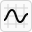
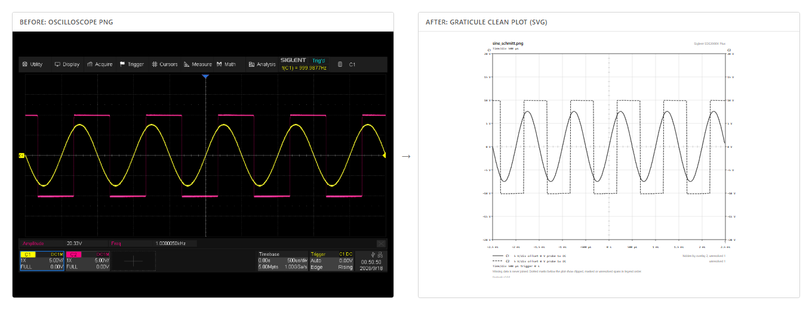
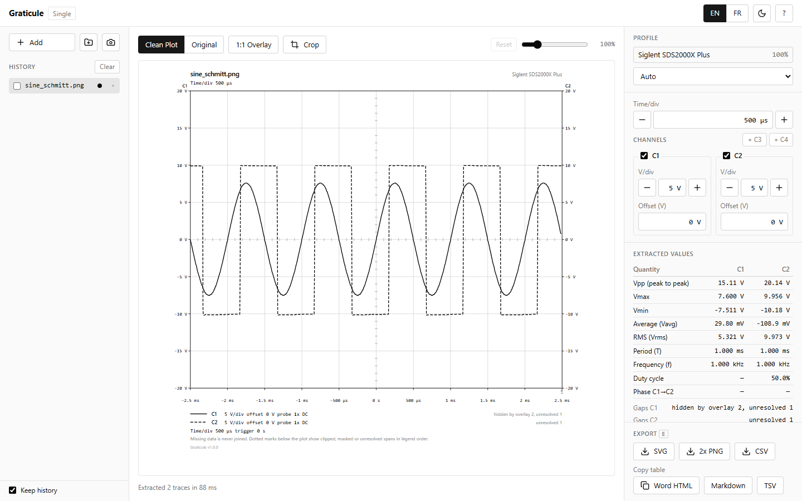
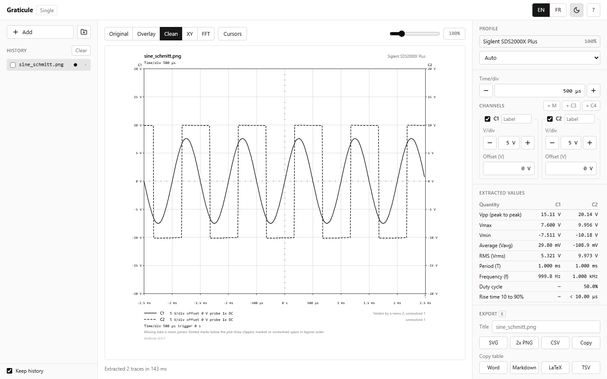

<p align="center">
  <picture>
    <source media="(prefers-color-scheme: dark)" srcset="docs/media/graticule-logo-dark.svg" />
    
  </picture>
</p>

<h1 align="center">Graticule</h1>

<p align="center">Graticule turns oscilloscope screenshots into clean plots and real data.</p>

<p align="center">
  <a href="https://sunsind.github.io/Graticule/"><strong>Open Graticule</strong></a><br />
  Runs in your browser. Nothing to install.
</p>

<p align="center">
  <picture></picture>
</p>

<p align="center">
  <picture></picture>
</p>

<details>
<summary>Light mode screenshots</summary>

<p align="center">
  <picture></picture>
</p>

<p align="center">
  <picture></picture>
</p>

</details>

Drop a screenshot from your scope or take a photo of the screen on your phone, click Extract, and you get a print ready plot, a CSV of every trace, and a measurement table you can paste into Word or LaTeX. Everything runs in your browser, so your files never leave your device.

## What it does

- Reads the grid, the time scale and the volts per division from the screenshot
- Extracts every visible channel as time and voltage data
- Measures Vpp, Vmax, Vmin, Vavg, Vrms, period, frequency, duty cycle and the phase between C1 and C2
- Measures rise time from 10 to 90%, fall time and overshoot on square waves
- Compares its numbers with the scope MEASURE bar
- Puts X1, X2, Y1 and Y2 cursors on the clean plot and reads Δt, 1/Δt, ΔV and phase
- Straightens tilted phone photos with a 4 corner box
- Builds a Bode plot from a folder of captures and finds the `-3 dB` cutoff, or both cutoffs for a band pass filter
- Exports SVG, 2x PNG, CSV and tables for Word, Markdown, LaTeX or TSV
- Copies the plot straight to your clipboard so you can paste it into a report
- Works in English and French

## How to use it

1. Open the app
2. Drop a screenshot, paste one with Ctrl+V, press O, or click Add
3. Click Extract when you are ready. Nothing runs before that
4. Check the scales on the right and fix them if needed. The plot updates by itself
5. Zoom with the slider or with Ctrl and the mouse wheel. Click the zoom percentage to go back to 100%
6. Export with the buttons at the bottom right

Add several files or a whole folder, or tick two or more captures in the history, then click Extract Bode to make a Bode plot.

## Cursors

Click Cursors or press C on a clean plot. Two dashed lines measure time and two dotted lines measure voltage. Drag them with the mouse or your finger, or click one and move it with the arrow keys. Hold Shift to move faster.

The bar above the plot shows X1, X2, Δt, 1/Δt, Y1, Y2 and ΔV. When the channel has a period, it also shows the phase between X1 and X2. Pick the channel from the menu on the left of the bar when more than one trace is on.

While the cursors are on, they are also drawn in the SVG, the PNG and the copied plot.

## Report ready figures

Type a title in the Export panel to replace the file name on the plot. Give each channel a label like Vin or Vout under Channels. The title and the labels show up in the SVG, the PNG, the CSV and the copied tables, and the title also names the files you download.

Click Copy or press Ctrl+C to copy a white 2x PNG of the plot. Paste it right into Word, Google Docs or PowerPoint.

Copy table gives you the measurements for Word, Markdown, LaTeX or TSV.

## History

Every capture you add stays in the history on the left, with its scales, its title, its labels, its cursors and its result. Click one to open it again. The history is saved in your browser, so it is still there after a refresh. It keeps your last 50 captures.

Clear asks you to confirm before it deletes anything. Turn off Keep history at the bottom of the left panel to stop saving. Your saved captures are deleted right away, and the ones from this visit stay open until you close the tab.

## Phone photos

On phones and tablets, tap the camera button to take a photo of the scope screen. Big photos are scaled down to 1920 px and turned the right way up. Graticule then checks the photo, and if it is blurry, tilted, too dark, too small or has glare, it tells you what to fix. You can retake the photo or use it anyway.

When a photo is tilted, click Straighten. Drag the 4 corners onto the 4 corners of the grid and click Apply crop. Graticule flattens the grid before it reads the traces, and the 1:1 overlay still lines up with the tilted photo.

A real screenshot from the scope always gives better results than a photo.

## Supported scopes

| Scope | Support |
| --- | --- |
| Siglent SDS2000X Plus | Native |
| Siglent SDS1000X E | Native |
| Siglent SDS800X HD | Native |
| Rigol DS1054Z | Native |
| Rigol DHO924 | Native |
| Rohde & Schwarz RTB2004 | Native |
| Tektronix DPO7104C | Native |
| Keysight DSOX1000 | Native |
| Anything else | Universal mode with a crop box |

Native scopes are found by themselves. You can also pick one by hand in the Profile menu.

In universal mode you drag the crop box onto the edge of the grid, then type the time scale and the volts per division. Click Cancel or Clean Plot if the box is already right. Crop has two shapes. Rectangle is best for screenshots and 4 corners is best for photos.

## Honest data

Graticule never guesses what it cannot see. When a trace is clipped, hidden by a cursor or a menu, or crosses another trace, that part is marked instead of filled in.

- The plot shows a dotted mark where data is missing
- The CSV leaves the cell empty and says why, like `clipped_high`
- In Bode mode, bad captures stay in the table with a reason and are never joined to the curve
- When an edge is too fast to measure, the rise or fall time shows as less than the value Graticule can see

## Shortcuts

| Key | Action |
| --- | --- |
| O | Add images |
| Ctrl+V | Paste a screenshot |
| E | Go to exports |
| T | Show or hide the 1:1 overlay |
| C | Show or hide the cursors |
| Ctrl+C | Copy the plot |
| Ctrl and wheel | Zoom the plot |
| Arrows | Move a crop corner or a cursor |
| Enter | Apply the crop |
| Escape | Cancel the crop or what you are typing |
| ? | Show or hide the shortcuts |

## Offline

Graticule works without internet. After your first visit the website keeps working offline, and you can install it like an app from your browser. When a new version comes out, the app updates itself the next time you open it online.

You can also download `graticule-portable.html` from the latest release. It is one file that opens in any browser, with no install and no internet.

## Command line

The same engine runs in Node and gives the exact same CSV as the browser.

```sh
npm run cli -- capture.png --csv --out capture.csv
npm run cli -- capture.png --svg --locale fr --out capture.svg
npm run cli -- capture.png --table --format latex
npm run cli -- photo.png --deskew 120,80,1800,60,1820,1010,100,1030 --csv --out photo.csv
npm run cli -- --bode ./sweep --table
```

## Accuracy

Measured across synthetic ground truth, 28 local Siglent captures, 18 public web screenshots from multiple scopes, and a public Rigol PNG and CSV capture pair.

| Check | Result |
| --- | --- |
| Synthetic ground truth (7 captures) | 0.24 px median vertical error (0.48 px p95), 0.015% median Vrms error |
| Siglent SDS2000X Plus | 28 of 28 local captures and 2 public captures matched |
| Rigol DS1054Z | 9 public captures matched, 0.57 px median error on C1 versus scope CSV |
| Other scopes and schematics | 7 public captures sent cleanly to universal mode with zero false matches |
| Active filter sweep (10 captures) | 10 of 10 accepted, 990 Hz cutoff, 0.003 dB median gain error |
| Browser and CLI | Exact same CSV byte for byte |

## Development

You need Node 22 or newer.

```sh
npm install
npm run dev
npm test
npm run build
npm run build:portable
```

Built with Vite and React. The engine in `src/core` has no browser or Node dependencies and runs in a Web Worker.
